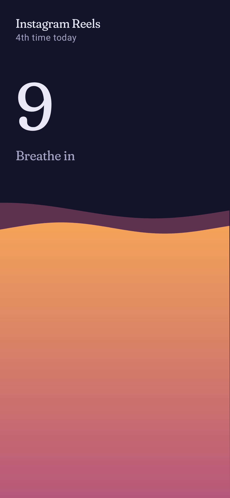
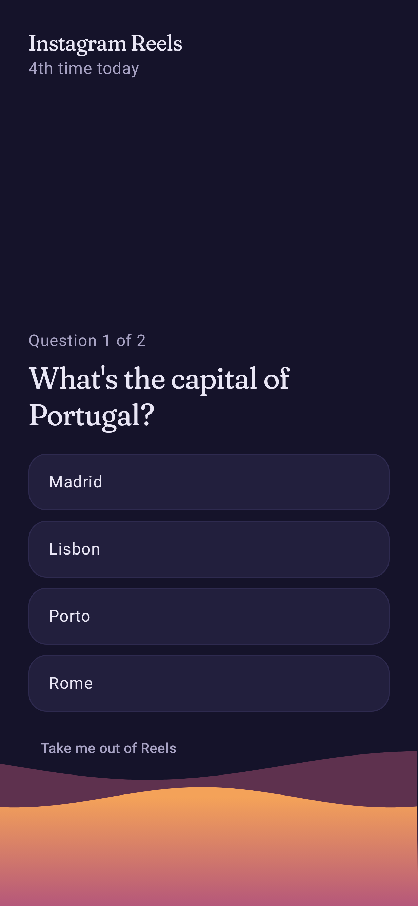
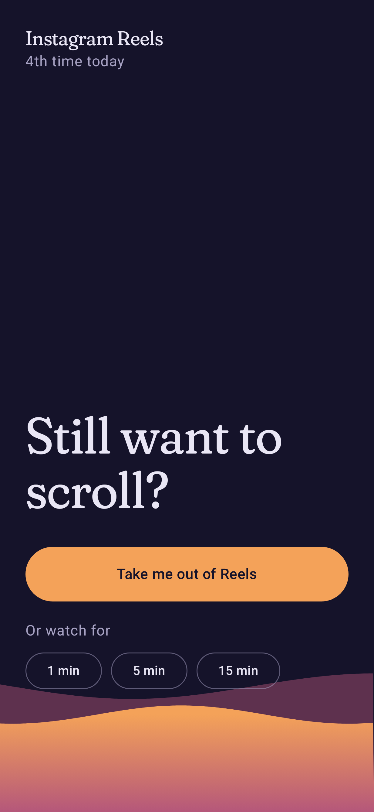
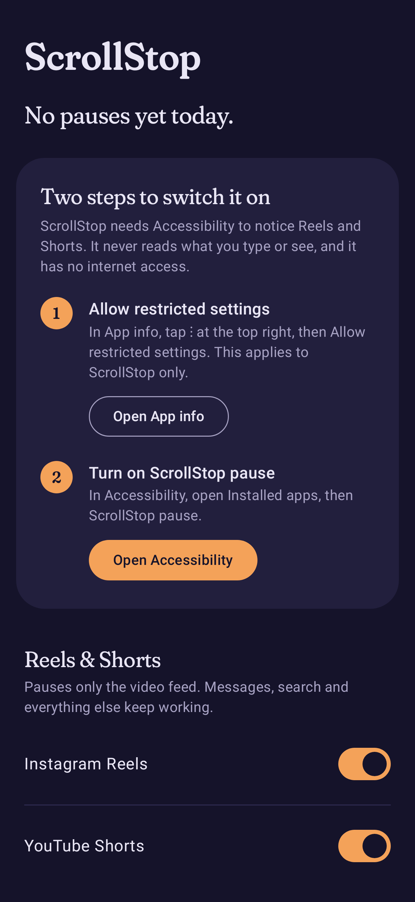

# ScrollStop

A small Android app in the spirit of *one sec*, focused on the worst doom-scroll traps:
**Instagram Reels** and **YouTube Shorts**. When you start one, ScrollStop shows a short breathing
pause and asks whether you really want to scroll. Say no and it takes you out of the feed, and
you keep using the rest of the app (messages, search, subscriptions) as normal.

It can also guard whole apps (TikTok, Reddit, …) with the same pause.

<p>
  
  
  
  
</p>

## Install

### [Download ScrollStop.apk](https://github.com/Senior-ai/ScrollStop/releases/latest/download/ScrollStop.apk)

That link always gives you the newest version. Reading this on a computer? Scan the code with
your phone's camera:


1. **Open the downloaded file.** If your browser asks, allow it to install unknown apps.
2. **If Android blocks the install** ("App blocked to protect your device"), it's because
   ScrollStop uses Accessibility and doesn't come from the Play Store. Turn these off just while
   you install, then turn them back on (ScrollStop stays installed):
   - Play Store → your profile picture → Play Protect → ⚙ → *Scan apps with Play Protect*
   - Samsung only: Settings → Security and privacy → *Auto Blocker*
3. **Open ScrollStop and follow its two setup steps.** First *Allow restricted settings*
   (App info → ⋮ → Allow restricted settings), then turn on *ScrollStop pause* in Accessibility.
   These apply to ScrollStop only.

**Updating:** tap the same download link and install over the old version. Your settings stay.
If you have a test build that was sent to you directly (1.0 to 1.5), uninstall it once first:
it was signed with a different key, so Android won't install over it.

**Is my download genuine?** Every release lists its checksum and signing certificate. See
[SECURITY.md](SECURITY.md#checking-an-apk-before-installing).

## What it does

- **Reels & Shorts guard** (on by default): pauses only the short-video feed, not the whole app.
  Choosing "No" gets you out of the feed: Back first, then Instagram's Home tab, then the
  phone's home screen if you're somehow still in it. The video behind the pause
  screen is paused while you decide.
- **Breathing pause** before every guarded app (3–20 s, your choice).
- **Or a quiz instead:** answer a multiple-choice question before you can carry on. Topics:
  mental maths, world capitals, English vocabulary, science basics, or **your own cards**
  (write question-and-answer pairs for anything you're learning). A wrong answer shows the right
  one and asks another. Everything is built in, so it still needs no internet.
- **Harder each time**: optionally +2 s of breathing for every repeat open of the same thing that
  day (up to 30 s), or one more quiz question every 3 repeat opens (up to 3).
- **Honest counter**: "You've tried to open Instagram 7 times today."
- **Time-boxed access**: if you do go in, you pick 1, 5 or 15 minutes.
- **Time's up**: when that time runs out while you're still in the app, ScrollStop steps in again.
- **Daily stats**: pauses today and how many times you walked away.

Everything stays on the phone. There is no network permission, account or tracking.

### How Reels/Shorts detection works

Inside Instagram and YouTube, ScrollStop checks the screen's layout for the full-screen Reels or
Shorts player by its view ID (for example `clips_viewer_view_pager` and `reel_recycler`). It
doesn't read any text. If an app update renames those views, the pause stops appearing for that
feed. Add the new ID to `ShortFormFeatures.kt` and rebuild. You can find it with Android Studio's
Layout Inspector, or with `adb shell uiautomator dump`.

## How it works

| Piece | File |
|---|---|
| Detects the foreground app, and the Reels/Shorts player inside Instagram/YouTube | `service/BlockerAccessibilityService.kt` |
| Which view IDs mark the Reels and Shorts players | `data/ShortFormFeatures.kt` |
| Pause, choice and time's-up screens (Jetpack Compose) | `ui/PauseScreen.kt` |
| Reels/Shorts pause drawn over the app; whole-app pause as its own screen | `ui/PauseOverlay.kt`, `ui/InterceptActivity.kt` |
| Setup screen: permission, stats, settings, app picker | `ui/MainActivity.kt` |
| Pure decision logic (unit tested) | `data/PauseRules.kt` |
| Quiz questions: generated maths, bundled topics, your own cards | `data/Quiz.kt` |
| Persisted settings, allowances and daily counters | `data/BlockerStore.kt` |

## Build

Requires JDK 17+ and the Android SDK (platform 35).

```bash
./gradlew testDebugUnitTest     # unit tests
./gradlew assembleRelease       # → app/build/outputs/apk/release/app-release.apk
```

Without a signing key, local release builds use the debug key, which is fine for testing on
your own phone.

**Releasing:** bump `versionName` (and `versionCode`) in `app/build.gradle.kts` and push to
`main`. GitHub Actions builds, tests and signs the APK and publishes it as a release, which the
download link above then serves. Signing needs the repository secrets described in
[SECURITY.md](SECURITY.md#your-signing-key).

## Safety

ScrollStop has **no internet permission and no other permissions**. It never reads text on
screen, and the only things it does are the steps that take you out of a feed after you say no.
The build fails if a permission is ever added. See
[SECURITY.md](SECURITY.md) for the full list and how to check a downloaded APK.

## Tips

- Some phones (Samsung, Xiaomi, Huawei…) stop background services aggressively. If the pause
  stops appearing, set ScrollStop's battery usage to **Unrestricted**.
- Prefer a computer? `adb install -r ScrollStop.apk` installs or updates without the Play
  Protect prompt (turn on Developer options → USB debugging first).

## Ideas for later

- More feeds: Facebook Reels, Snapchat Spotlight, YouTube's Shorts shelf on the home screen
- Daily hard limits ("max 3 opens of TikTok per day")
- Schedules (stronger pauses during work hours or after 23:00)
- Home-screen widget with today's stats
- Guarding specific websites in the browser

## Credits

Headlines and numbers use [Fraunces](https://github.com/undercasetype/Fraunces) by Undercase
Type, under the SIL Open Font License (see `third_party/fraunces/OFL.txt`).
